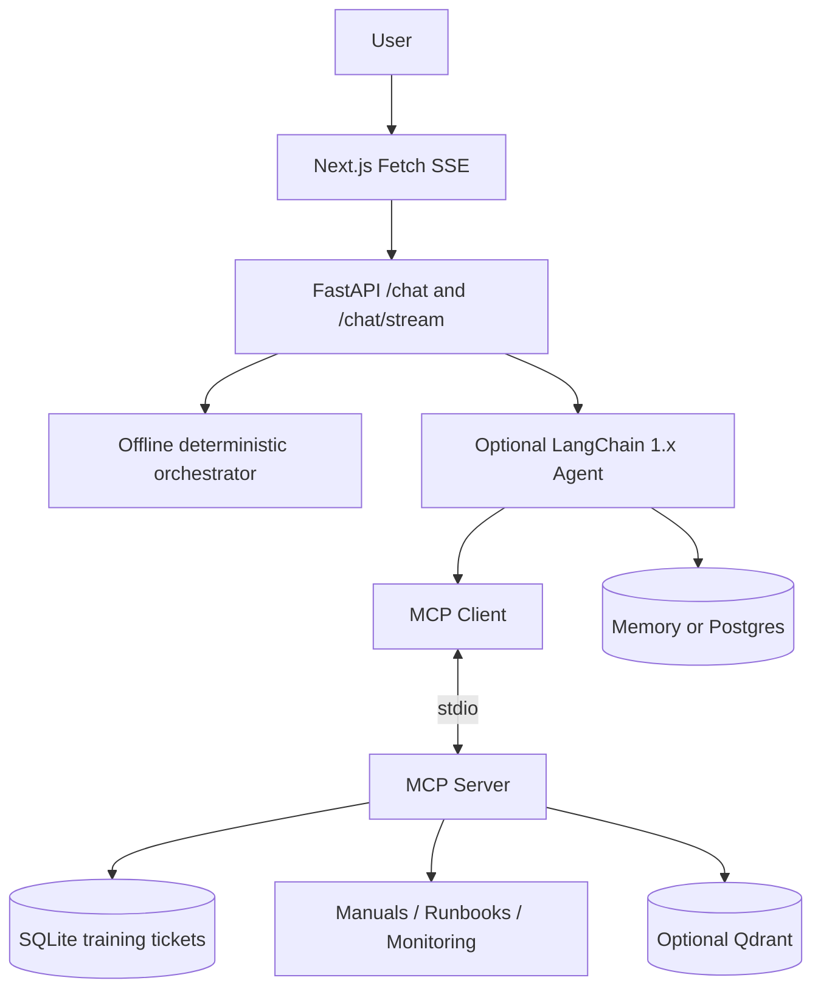

# Architecture and capability boundaries

## Trade-offs

- **Tool vs Resource vs Prompt:** choose dynamic operations as Tool, URI-addressable static context as Resource, reusable templates as Prompt. The MCP client must separately demonstrate these types; simply registering them is not enough.
- **Agent-driven retrieval:** flexible and selective but potentially adds LLM round-trips. For some fixed workflows pre-retrieval is cheaper.
- **stdio:** each subprocess lifetime is independent; never rely on in-memory ticket state between sessions. SQLite is the deliberately simple replacement.
- **SSE:** the browser gets server-to-client updates over HTTP; this is unrelated to the MCP transport. SSE HTTP chunks are not aligned to message boundaries.
- **State:** thread_id identifies conversation; it is not authentication. A Postgres checkpointer persists graph state but does not automatically authorize users.
- **Observability vs Eval:** traces describe steps; evaluations judge goal fulfillment. Keep both.

## Schema contract

- `POST /chat`: `{message, thread_id?}` -> `{thread_id, answer, events}`.
- `POST /chat/stream`: same request -> SSE `start`, `state`, `token`, `done` or `error`.
- `POST /chat/ui-stream`: AI SDK UI Message Stream v1 start/text-delta/finish/[DONE] (not the same format as custom SSE).
- `POST /tickets/approve`: `{title, description, request_id}` plus private `X-Demo-Admin-Key` -> created ticket result.
- MCP Tools: search_operations_manual, search_issue_tickets, read_monitoring_status, create_issue_ticket.
- MCP Resource: `runbook://incident/{incident_type}`.
- MCP Prompt: incident_diagnosis.
